# macos-app-cleaner - macOS 全域与内核级深度清理技能

## 核心目标

在 macOS 环境下，针对目标软件执行**外科手术级、全域覆盖且触达系统底层子系统**的彻底卸载与残留排查。不仅涵盖常规桌面 GUI 应用（`.app`）和终端命令行软件（CLI、AI Agent 运行时），更深入 macOS 的**权限控制、钥匙串凭据、后台任务管理、安装收据及系统缓存机制**，消除任何形式的幽灵项与暗角，实现真正意义上的 **100% 系统级 0 残留**。

## 触发场景

- 用户要求彻底卸载、清理某款 macOS 桌面软件（如：“彻底卸载 QQ 浏览器”、“删除微信支付证书工具”）
- 用户要求排查并删除终端 CLI 工具或智能体运行时（如：“把 cursor-agent 删干净”、“排查哪个命令指向了它”）
- 软件已删但在系统设置“允许在后台”留有无法关闭的幽灵开关，或右键“打开方式”依然有灰色残影
- 删除了数十 GB 缓存但磁盘可用空间未增加（APFS 本地快照锁死空间排查）
- 磁盘“系统数据”或未知目录暴增，需要排查孤儿残留（Orphaned Files）

---

## 清理维度深度全景图

```mermaid
flowchart TD
    A["🎯 目标软件彻底清理"] --> B["1. 表现层：实体与入口"]
    A --> C["2. 数据层：用户资源库与隐藏配置"]
    A --> D["3. 暗水区：宿主内部存储与系统级缓存"]
    A --> E["4. 系统子系统层：底层注册与权限"]
    A --> F["5. 存储层：APFS 本地快照瘦身"]

    B --> B1["GUI /Applications/*.app 与 ~/.Trash/*"]
    B --> B2["CLI $PATH 软链接与入口"]
    B --> B3["LaunchAgents / LaunchDaemons"]

    C --> C1["Application Support / Caches / Preferences"]
    C --> C2["Containers / Group Containers"]
    C --> C3["~/.<Tool> / ~/.config / ~/Downloads"]

    D --> D1["IDE globalStorage 私有 Worker 副本"]
    D --> D2["~/.local/share 实际物理版本库"]
    D --> D3["/var/folders Darwin 系统缓存 (Metal GPU / ShipIt)"]

    E --> E1["BTM 幽灵后台登录项 (sfltool)"]
    E --> E2["TCC 隐私权限数据库 (tccutil)"]
    E --> E3["Keychain 钥匙串密码凭证 (security)"]
    E --> E4["PKG 安装收据 (pkgutil)"]
    E --> E5["LaunchServices 打开方式与废纸篓幽灵注销 (lsregister -u)"]
    E --> E6["Shell/Git 注入与特权工具 (rc/gitconfig/PrivilegedTools)"]

    F --> F1["APFS 本地快照瘦身释放 (tmutil)"]
```



---

## 核心工作流与操作规程

### 第一阶段：活动进程与常驻服务审计（优先灭活）

1. **终止活跃进程**：
   ```bash
   ps aux | grep -i "<TargetName>" | grep -v grep
   ```
   *若有活跃进程，按 PID 正常终止或引导退出。*

2. **审计并注销后台常驻守护**：
   ```bash
   ls -la ~/Library/LaunchAgents /Library/LaunchAgents /Library/LaunchDaemons 2>/dev/null | grep -i "<TargetName>"
   ```
   *若发现 `.plist` 文件，**必须先使用 `launchctl unload <plist路径>` 卸载服务**，再删除文件。*

3. **审计 BTM 幽灵后台项（Background Task Management）**：
   - 检查系统设置中“允许在后台”残留的无图标项：
     ```bash
     sfltool dumpbtm 2>/dev/null | grep -i -C 2 "<TargetName>"
     ```

---

### 第二阶段：全域定位本体与入口

1. **GUI 软件本体**：
   - 检查 `/Applications/<AppName>.app` 与 `~/Applications/<AppName>.app`。
   - **排查废纸篓挂起状态**：检查 `~/.Trash/<AppName>.app`。用户常通过拖拽到废纸篓“卸载”，但在清空废纸篓前，系统底层（如 LaunchServices）仍会维持有效注册与右键菜单关联。
2. **CLI 终端命令入口**：
   - 检查多层级软链接与命令遮挡：`which -a <command>`（确认清理后是否有被遮挡工具显现）
   - 检查用户层 Bin 目录：`~/.local/bin/`、`/usr/local/bin/`、`/opt/homebrew/bin/`
3. **PKG 安装包收据（Receipts）检查**：
   - 若软件曾通过 `.pkg` 安装器安装，检查系统安装注册表：
     ```bash
     pkgutil --pkgs | grep -i "<TargetName>"
     ```

---

### 第三阶段：全盘深度扫描与隐藏副本挖掘

针对应用的英文名、Bundle Identifier（例如 `com.tencent.QQBrowser`、`cn.trae.solo.app`）及常见中文别名展开全盘扫描，并使用 `du -sh` 统计可释放体积：

1. **用户资源库核心路径 (`~/Library/`)**：
   - **用户数据与扩展**：`~/Library/Application Support/<AppName>`
   - **离线与网页缓存**：`~/Library/Caches/<BundleID>` 或 `<AppName>`
   - **偏好设置配置文件**：`~/Library/Preferences/<BundleID>.plist` 与 `~/Library/Preferences/ByHost/<BundleID>.*.plist`
   - **窗口与崩溃状态快照**：`~/Library/Saved Application State/<BundleID>.savedState`
   - **沙盒隔离容器**：`~/Library/Containers/<BundleID>` 与 `~/Library/Group Containers/<GroupID>`
   - **网络会话与日志**：`~/Library/HTTPStorages/<BundleID>`、`~/Library/WebKit/<BundleID>`、`~/Library/Logs/<AppName>`

2. **Darwin 系统级硬件与更新专有缓存区 (`/var/folders/`)（极深盲区）**：
   - macOS 将进程的硬件加速与编译管线缓存存放在 `/var/folders/*/*/*/C/<BundleID>`（如 Metal GPU 着色器 `com.apple.metal`、`com.apple.gpuarchiver`、`com.apple.metalfe`）。
   - 将 Electron / Squirrel.Mac ShipIt 的自动更新组件及解压区存放在 `/var/folders/*/*/*/T/<BundleID>.ShipIt.*`。
   - 这类缓存即使拖拽删除了软件也常年滞留，扫描命令：
     ```bash
     find /var/folders -iname "*<BundleID>*" 2>/dev/null
     ```

3. **宿主软件深层内嵌存储（常规工具盲区）**：
   - 排查 Electron / IDE 的全局插件私有缓存：
     `~/Library/Application Support/{Cursor,Code}/User/globalStorage/*<TargetName>*`
   - 检查编辑器内部日志目录中的历史会话调试包。

4. **用户根目录隐藏配置与运行库**：
   - 检查 `~/.<ToolName>`（重点核对是否存有历史数据库、配置或设计文档）
   - 检查 `~/.local/share/<ToolName>/`（CLI 物理版本库，常占数百 MB）
   - 检查 `~/.config/<ToolName>`

5. **下载与临时文件区**：
   - 检查 `~/Downloads/*<TargetName>*`（工具生成导出的数据、解压包、DMG 镜像）
   - 检查 `/tmp/*<TargetName>*` 与 `/var/tmp/*<TargetName>*`

6. **取证级外围与环境注入排查**：
   - **Shell 配置文件注入**：排查 `~/.zshrc`、`~/.zprofile`、`~/.zshenv`、`~/.bashrc`、`~/.profile` 中是否有注入的环境变量、PATH 扩充、函数或别名。
   - **Git 全局配置排查**：排查 `~/.gitconfig` 中是否有注册为 credential helper、diff tool 或 merge tool 的残留项。
   - **系统特权工具与内核扩展**：排查 `/Library/PrivilegedHelperTools` 及 `systemextensionsctl list`。
   - **崩溃诊断与转储日志**：排查 `~/Library/Logs/DiagnosticReports/` 与 `/Library/Logs/DiagnosticReports/`。
   - **本地网络解析与代理劫持**：核对 `/etc/hosts` 是否存在该软件私自添加的本地重定向条目。

---

### 第四阶段：安全护栏与白名单过滤（铁律）

> [!CAUTION]
> **绝对禁止未审先删！向用户汇报前必须严格过滤以下资产：**

1. **同厂商生态矩阵/兄弟产品白名单隔离**：
   - 许多厂商拥有同名/同系家族产品（如 `TraeWork` 与 `Trae CN` IDE；`VS Code` 与 `VS Code Insiders`；`微信` 与 `企业微信`；`Chrome` 与 `Chrome Canary`）。
   - **必须以 Bundle Identifier 为核心基准建立精准隔离**，严禁使用过于宽泛的单字通配符（如盲目 `rm -rf *trae*`），必须明确向用户区分两者的边界，绝不误伤正在使用的生产力工具。
2. **用户工程代码与工作空间隔离**：
   - 全盘搜索结果必须使用 `grep -v` 显式排除 `~/Documents/`、`~/Desktop/`、`~/Projects/`、`~/work-code/` 等用户源码目录。
   - 严禁误删工程项目中包含同名关键字的测试用例、SDK 包或开发文档。
3. **高敏感密钥与凭证安全提示**：
   - 发现 `.pem`、`.p12`、`cert.zip`、`id_rsa`、私钥或包含 API Key 的配置文件时，**必须在清单中单独标红并附带安全警告**，提示用户确认线上服务是否仍依赖该凭证。
4. **个人社交与系统原生数据保护**：
   - 严格区分软件本体残留与微信/QQ等社交客户端内接收到的历史聊天附件（如 `com.tencent.xinWeChat/Data/Documents/xwechat_files/...`）。
   - 严格区分独立软件缓存与浏览器中访问该应用 Web 版留下的 Cookie/IndexedDB（如 Chrome 的 `https_app.example.com`）。

---

### 第五阶段：清单汇总与两阶段清理

1. **结构化呈现清理清单**：
   - 列出所有发现的文件/文件夹绝对路径及其占用空间（MB/GB）。
   - 划分为：**【可安全清理项】**（纯运行缓存、废弃数据库）与 **【需人工确认项】**（历史计划文档、导出证书等）。
2. **在获得用户明确授权后，执行物理清除**：
   ```bash
   rm -rf <ConfirmedPaths>
   ```

---

### 第六阶段：进阶深水区——系统子系统级深度清理（内核级）

物理文件删除后，针对目标应用实施底层注册表与子系统的外科手术式收尾：

1. **TCC 隐私权限重置**：
   - 清除 macOS 隐私数据库中遗留的摄像头、磁盘、辅助功能等授权记录：
     ```bash
     tccutil reset All <BundleID> 2>/dev/null || true
     ```

2. **macOS 钥匙串（Keychain）凭据注销**：
   - 排查应用存留在系统钥匙串中的 Token、加密凭证或自签证书：
     ```bash
     security find-generic-password -s "<TargetName>" 2>/dev/null && \
     security delete-generic-password -s "<TargetName>" 2>/dev/null || true
     ```

3. **`cfprefsd` 偏好守护内存落盘防回写**：
   - 先调用系统原生 API 删除偏好域，再强制刷新守护进程：
     ```bash
     defaults delete <BundleID> 2>/dev/null || true
     killall cfprefsd 2>/dev/null || true
     ```

4. **清除 PKG 安装收据注册**：
   ```bash
   pkgutil --forget <PackageID> 2>/dev/null || true
   ```

5. **重建 LaunchServices 打开方式数据库与废纸篓注销**：
   - **废纸篓幽灵条目注销**：若应用本体已被移入废纸篓（`~/.Trash/<AppName>.app`），必须先显式解绑，否则全局重建会把废纸篓中的 App 重新索引进系统：
     ```bash
     /System/Library/Frameworks/CoreServices.framework/Frameworks/LaunchServices.framework/Support/lsregister -u "$HOME/.Trash/<AppName>.app" 2>/dev/null || true
     ```
   - **消除右键“打开方式”中的残留灰色幽灵图标**：
     ```bash
     /System/Library/Frameworks/CoreServices.framework/Frameworks/LaunchServices.framework/Support/lsregister -kill -r -domain local -domain system -domain user
     ```

6. **物理抹除 Darwin 系统专有缓存**：
   - 清理 Metal 着色器与 Electron 升级框架底层临时区：
     ```bash
     rm -rf /var/folders/*/*/*/C/<BundleID>* /var/folders/*/*/*/T/<BundleID>* 2>/dev/null || true
     ```

---

### 第七阶段：二次复查与 APFS 本地快照空间释放

1. **Spotlight 与全盘索引二次复查**：
   ```bash
   mdfind 'kMDItemFSName == "*<TargetName>*"c' 2>/dev/null | grep -v "/Documents/"
   which -a <TargetCommand> 2>&1
   ```
2. **APFS 本地快照空间锁死排查（解决“删了文件空间却没变大”问题）**：
   - 若删除了数十 GB 文件但 `df -h` 空间未释放，检查本地快照：
     ```bash
     tmutil listlocalsnapshots / 2>/dev/null
     # 如有必要且用户授权，收缩快照释放物理空间：
     tmutil thinlocalsnapshots / 99999999999 4 2>/dev/null || true
     ```
3. **输出最终验证报告**：向用户反馈已释放的总空间及系统当前状态。

---

## 必须检查的关键目录清单速查表

| 层级 | 检查目录路径 | 重点排查内容 |
| :--- | :--- | :--- |
| **入口与常驻** | `/Applications/*.app`、`~/Applications/*.app` | GUI 应用本体 |
| | `~/.Trash/*.app` | 废纸篓中挂起的旧应用本体（需配合 `lsregister -u` 注销） |
| | `~/.local/bin/`、`/usr/local/bin/`、`/opt/homebrew/bin/` | CLI 可执行程序与软链接符号 |
| | `~/Library/LaunchAgents/`、`/Library/LaunchAgents/`、`/Library/LaunchDaemons/` | 开机自启项与后台常驻守护服务 |
| | BTM (Background Task Management) 系统存储 | 系统设置中的“允许在后台”幽灵开关 |
| **应用支持库** | `~/Library/Application Support/<AppName>` | 核心应用数据、扩展插件、内部离线库 |
| | `~/Library/Caches/<BundleID 或 AppName>` | 网络与本地大体积缓存 |
| | `~/Library/Preferences/<BundleID>.plist` 与 `ByHost/` | 系统偏好设置参数与配置项 |
| | `~/Library/Saved Application State/<BundleID>.savedState` | 应用退出前的窗口与页面状态快照 |
| | `~/Library/Containers/<BundleID>` | macOS App 沙盒隔离运行目录 |
| | `~/Library/Group Containers/<GroupID>` | 跨应用共享数据容器 |
| | `~/Library/HTTPStorages/<BundleID>`、`WebKit/`、`Logs/` | 网络请求临时存储与运行错误日志 |
| **用户与环境** | `~/.<ToolName>/`、`~/.config/<ToolName>/` | 隐藏主配置目录、本地 SQLite 数据库 |
| | `~/.local/share/<ToolName>/` | 命令行工具实际二进制版本库（体积通常较大） |
| | `~/Downloads/` | 工具导出的私钥/证书文件、解压目录、DMG 镜像 |
| | `~/.zshrc`、`~/.bashrc`、`~/.gitconfig` | 环境变量注入、PATH 扩充与 Git 凭据助手劫持 |
| **系统底层盲区** | `/var/folders/*/*/*/C/<BundleID>/` | **Darwin 硬件缓存**：Metal GPU 编译着色器与管线缓存 |
| | `/var/folders/*/*/*/T/<BundleID>.ShipIt.*/` | **更新临时区**：Electron 自动更新临时包与挂起解压目录 |
| | `~/Library/Application Support/{Cursor,Code}/User/globalStorage/` | IDE 宿主内部偷偷缓存的 Worker 或运行时副本 |
| | `/Library/PrivilegedHelperTools`、`systemextensionsctl` | root 权限常驻辅助工具与内核/系统扩展 |
| **系统子系统** | `~/Library/Application Support/com.apple.TCC/TCC.db` | TCC 隐私权限授权记录 (`tccutil`) |
| | `~/Library/Keychains/login.keychain-db` | 钥匙串密码、Token 与数字证书 (`security`) |
| | `/var/db/receipts/` | PKG 安装包打包收据与 BOM 登记表 (`pkgutil`) |
| | LaunchServices 数据库 | 右键“打开方式”关联缓存 (`lsregister`) |

---

## 质量自检清单

- [ ] 是否在删除前排查并停止了后台常驻进程与自启守护（LaunchAgents/Daemons）
- [ ] 是否排查了同厂商矩阵/兄弟产品并建立基于 Bundle ID 的白名单隔离（防止误删生产力工具）
- [ ] 是否检查了 CLI 符号链接、命令遮挡（`which -a`）与实际版本库（`~/.local/share/`）
- [ ] 是否排查了 Shell 环境变量、别名注入（`~/.zshrc`）及 Git 全局配置（`~/.gitconfig`）
- [ ] 是否挖掘了 Darwin 系统缓存（`/var/folders/` 下 Metal GPU 着色器与 ShipIt 临时目录）
- [ ] 是否挖掘了宿主 IDE / Electron 的全局内部缓存（globalStorage）
- [ ] 是否绝对排除了用户工作目录中的开发源码（Documents/Projects/work-code）
- [ ] 是否对私钥、证书及敏感凭证进行了高危警告提示
- [ ] 是否执行了 TCC 隐私权限重置与钥匙串凭证注销
- [ ] 是否针对废纸篓挂起应用执行了 `lsregister -u` 注销并刷新了打开方式缓存
- [ ] 是否排查了 APFS 本地快照锁死导致的磁盘空间不增长问题
- [ ] 是否在执行删除后完成了 Spotlight 与文件系统的二次复查验证
